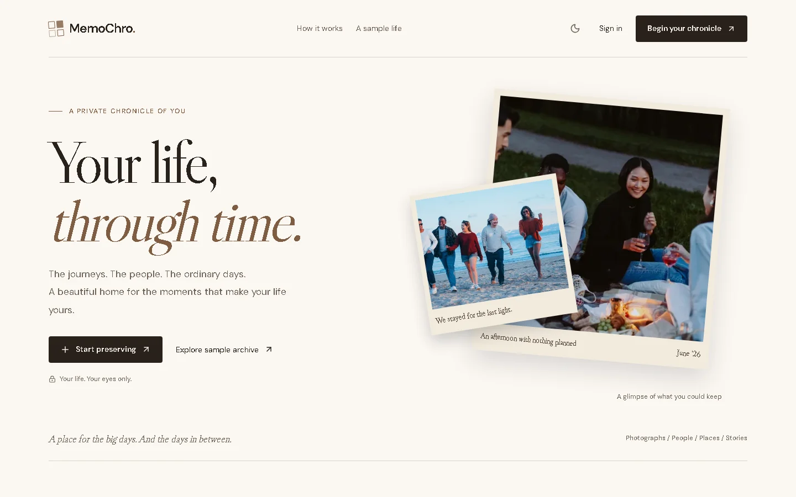
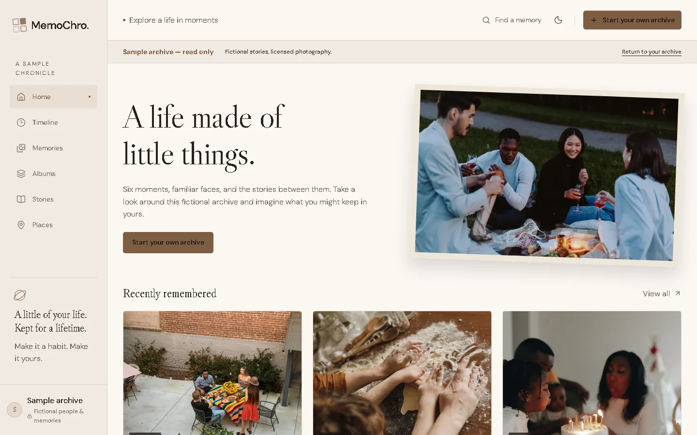

# MemoChro

**Your life, through time.** MemoChro is a private home for the moments that make a life: the big days, the ordinary afternoons, the people beside you, and the stories photographs cannot tell on their own. Preserve memories with photos and reflections, follow them through time, and gather them into albums.



## Explore the idea

The [sample archive](https://memochro-preview-eyzen08.vercel.app/demo) lets you browse a fictional life through memories, a timeline, albums, stories, and places. Its sample records are read-only and never become part of anyone's personal archive. The preview is protected by Vercel sign-in, followed by MemoChro's own sign-in for personal archives.



## What you can keep

- **Memories:** Save a date, photographs, captions, a reflection, mood, tags, and the people or place involved.
- **Timeline and search:** Revisit moments chronologically or find them with text and filters.
- **Albums and stories:** Bring related moments together and write what a photograph cannot hold.
- **Your archive:** Manage your profile and privacy, revisit originals in an export, or delete your account and its archive.

Personal records are protected by account authentication, row-level database rules, and private photo storage. The six photographic examples are licensed sample assets with fictional narratives; see [photo credits](docs/PHOTO_CREDITS.md).

## Tech stack

| Layer | Tools |
|---|---|
| App | Next.js 16 App Router, React 19, TypeScript |
| Design | Native CSS, Libre Caslon Display, DM Sans, Lucide icons |
| Data and identity | Supabase Auth, PostgreSQL with row-level security, private Supabase Storage |
| Media | Sharp for validated image previews and original-photo export |
| Quality and hosting | Node test runner, Playwright, ESLint, Vercel |

## Run locally

Use Node.js 24 and npm. Set up a dedicated Supabase project and apply the migrations in [`supabase/migrations`](supabase/migrations); they create the private `memory-media` storage bucket. Configure Supabase email authentication with the local Site URL and callback URL as described in the [deployment guide](docs/DEPLOYMENT.md).

```powershell
npm ci
Copy-Item .env.example .env.local
# Fill in the values in .env.local for your Supabase project.
npm run dev
```

Open `http://127.0.0.1:3000`. The sample archive at `/demo` can be explored without creating a personal account. The application uses these environment variables:

| Variable | Purpose |
|---|---|
| `NEXT_PUBLIC_SUPABASE_URL` | Supabase project URL |
| `NEXT_PUBLIC_SUPABASE_PUBLISHABLE_KEY` | Publishable client key; authorization is enforced by row-level security |
| `NEXT_PUBLIC_SITE_URL` | Exact app origin for authentication callbacks, such as `http://127.0.0.1:3000` |

Keep `.env.local`, test credentials, and private exports out of Git. Do not use a Supabase service-role key as the publishable key.

## Check the project

```powershell
npm test
npm run typecheck
npm run lint
npm run build
```

Browser tests use disposable accounts and a running local server; follow the [testing guide](docs/TESTING.md) before running them.

## Project status and documentation

MemoChro is a working initial release with a protected preview. Public production launch still needs verified email delivery and the remaining checks in the [implementation checklist](docs/IMPLEMENTATION_CHECKLIST.md). The source repository being public does not make personal archives or the preview public.

- [Architecture](docs/ARCHITECTURE.md) and [database schema](docs/DATABASE_SCHEMA.md)
- [Security and privacy design](docs/SECURITY_AND_PRIVACY.md)
- [Testing and evidence](docs/TESTING.md)
- [Deployment and recovery](docs/DEPLOYMENT.md)
- [Photography credits](docs/PHOTO_CREDITS.md)

**License:** No code reuse license has been granted. The sample photographs and fonts have their own licenses; see their credits and bundled license files.
