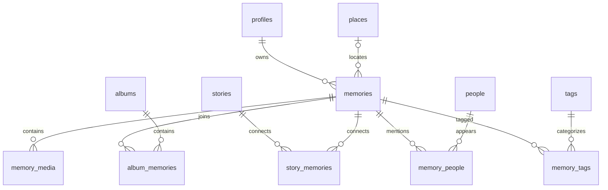

# Database schema

Design before migration. Every record has an owner referencing `auth.users`, with cascading account deletion. UUID IDs are database generated. Each entity has a unique `(id, user_id)` key for composite foreign keys. RLS permits only `auth.uid() = user_id`, with USING and WITH CHECK.

| Table | Fields and purpose |
| --- | --- |
| profiles | user_id PK, display_name; one per account |
| memories | id, user_id, title, memory_date, memory_time, description, mood, favorite, place_id, deleting, created_at |
| memory_media | id, user_id, memory_id, path, preview_path, caption, position; private original and preview |
| albums | id, user_id, title, description, cover_media_id, created_at |
| album_memories | user_id, album_id, memory_id, position; unique membership |
| stories | id, user_id, title, body, status draft/saved, cover_media_id, created_at |
| story_memories | user_id, story_id, memory_id; unique association |
| places | id, user_id, name, description, address, latitude, longitude |
| people | id, user_id, name, relationship, note |
| memory_people | user_id, memory_id, person_id |
| tags | id, user_id, name; unique per owner |
| memory_tags | user_id, memory_id, tag_id |

Albums, stories, places and people delete relationships, never underlying memories. Deleting memories removes join records; media objects must be removed through Storage before deleting their metadata. Covers become null when their media is removed. Cross-owner relationships fail composite FKs even if a request bypasses application validation. Date/owner and join indexes support paginated archive queries. Search uses indexed PostgreSQL full text for memory and story text, with owned tag/people/place lookup. Plain text story content prevents stored HTML injection.

Storage bucket `memory-media` is private, JPEG/PNG/WebP only, 10 MiB maximum per file. Object names are `user_id/memory_id/random_uuid.ext`; RLS checks both owner folder and owned memory. Signed URLs expire after 5 minutes. No arbitrary remote media URL is accepted as an upload.

Implementation refinement: object basenames use SHA-256 content hashes rather than random IDs so retries deduplicate. Preview names are derived from the original hash and remain under the same private owner/memory prefix. The `deleting` flag denies new uploads while folder cleanup runs. Restrictive insert/update policies enforce that condition. Foreign-key indexes cover both sides of each relationship.
